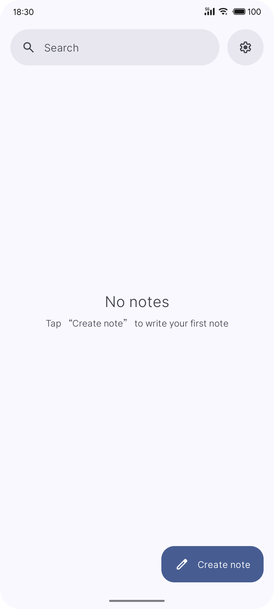
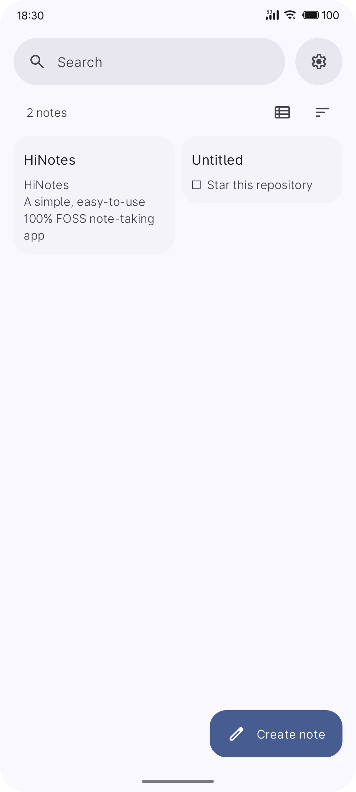
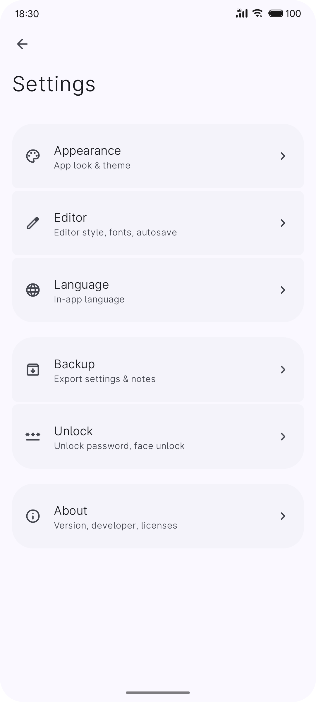
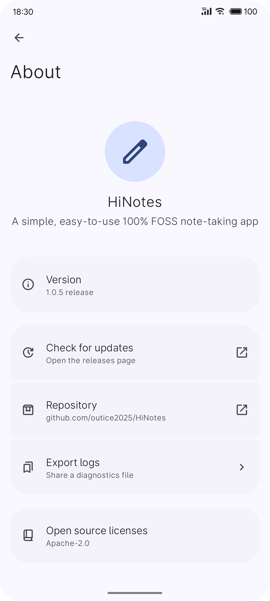

<a id="user-content-hinotes"></a>

<div align="center">
    
</div>

<div align="center">
    <h1>HiNotes</h1>
    <p>简单易用的 100% FOSS 笔记应用</p>
</div>

<div align="center">

[English](README.md) · 简体中文

</div>

---

<details>
<summary><b>截图</b></summary>

| 首页 | 笔记 | 设置 | 关于 |
| :---: | :---: | :---: | :---: |
|  |  |  |  |
| 空状态 | 列表与网格 | 设置 | 关于 |

</details>

---

简单易用的 100% FOSS Android 笔记应用，使用 Jetpack Compose 与 Material 3 Expressive 构建。

本地优先：笔记与应用设置均保存在本地。应用不申请 INTERNET 权限。

### 功能

**笔记**
- 新建、编辑、删除笔记。
- 按标题与正文搜索；按最近修改、创建时间或标题排序。
- 首页支持单列列表或两列瀑布流网格。
- 支持以 Markdown 格式书写笔记。
- 支持显示图片。
- 长按进入多选，可批量操作。
- 笔记可分享为文本或 Markdown 附件。
- 支持锁定、置顶笔记。

**微件**
- 桌面微件显示一篇笔记，添加时为每个微件单独选择笔记。
- 标题固定，正文在下方滚动，不显示滚动条。
- 显示笔记中的图片，任务列表画成复选框。
- 可隐藏标题，此时正文占满整张卡片。
- 配色跟随应用配色方案，并跟随 Markdown 开关。
- 可单独设置微件的字号与字重。

**编辑器**
- 支持 Markdown 编辑/预览笔记。
- 支持笔记内查找。
- 支持快捷工具栏。
- 支持自动保存。
- 属性面板显示笔记信息。

**外观**
- Material You 配色方案/动态取色。
- 支持 OLED 深色模式。
- 支持字号、字重调节。

**备份**
- 支持导出/导入设置、笔记。
- 支持恢复默认设置。
- 支持导出诊断报告。

**隐私**
- 无统计、无追踪、无账号。
- 支持应用内屏幕保护。
- 支持密码解锁应用。
- 笔记与设置保存在本地。
- 应用不发起任何网络请求。

**语言**
- 支持英文、简体中文。

### 构建

需要 JDK 17+，以及包含 platform 37 的 Android SDK（build-tools 版本由 Android Gradle Plugin 决定）。

```bash
./gradlew :app:assembleDebug      # 调试版
./gradlew :app:assembleRelease    # 发布版；存在 keystore.properties 时自动签名
```

`local.properties` 必须指向你的 SDK：

```properties
sdk.dir=/path/to/AndroidSDK
```

### Release 签名

`app/build.gradle.kts` 会读取项目根目录下的 `keystore.properties`（已被 gitignore）：

```properties
storeFile=keystore/hinotes-release.jks
storePassword=…
keyAlias=…
keyPassword=…
```

缺少该文件时 release 变体会构建为未签名版本，而不是直接失败。每次发布还会把 APK 复制到
`build/` 之外的 `releases/v<版本号>/`，因此 `clean` 不会毁掉上一版交付物。

### 目录结构

```
app/src/main/java/com/hiapps/hinotes/
├── MainActivity.kt      应用主 Activity：边到边、主题装配
├── data/                笔记、SQLite 存储、归档、设置、密码存储、生物识别
├── ui/                  路由、ViewModel、锁屏、组件、屏幕、主题
└── widget/              桌面微件：提供者、集合服务、选择器
```

`widget/` 里还有应用的第二个 Activity，也是唯一导出的入口：添加微件时由启动器打开的笔记选择器。

`tools/` 存放应用图标、符号矢量图与强调色配色的生成脚本，以及用来看字形、圆角半径的渲染脚本；
`tools/verify/` 存放各项检查，`sweep.ps1` 会依次运行全部检查并报告归档的 APK：

```bash
pwsh -File tools/verify/sweep.ps1        # 下列全部检查，外加 APK 的签名与哈希
pwsh -File tools/verify/run.ps1          # 归档、Markdown、微件文本、主题与文档选择的检查，在 JVM 上执行
python tools/verify/check_migrations.py  # 每一条笔记数据库升级路径，用 SQLite 验证
python tools/verify/audit_resources.py   # 字符串、图标、矢量图引用审计
python tools/verify/check_icon_geometry.py
```

### 许可证

本项目采用 Apache License 2.0 。
